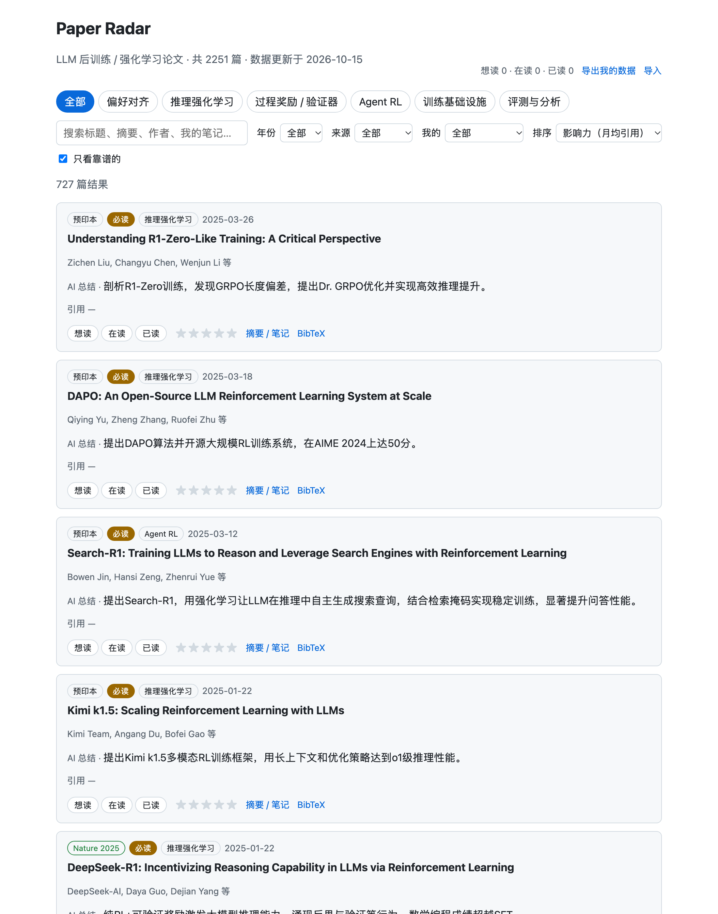
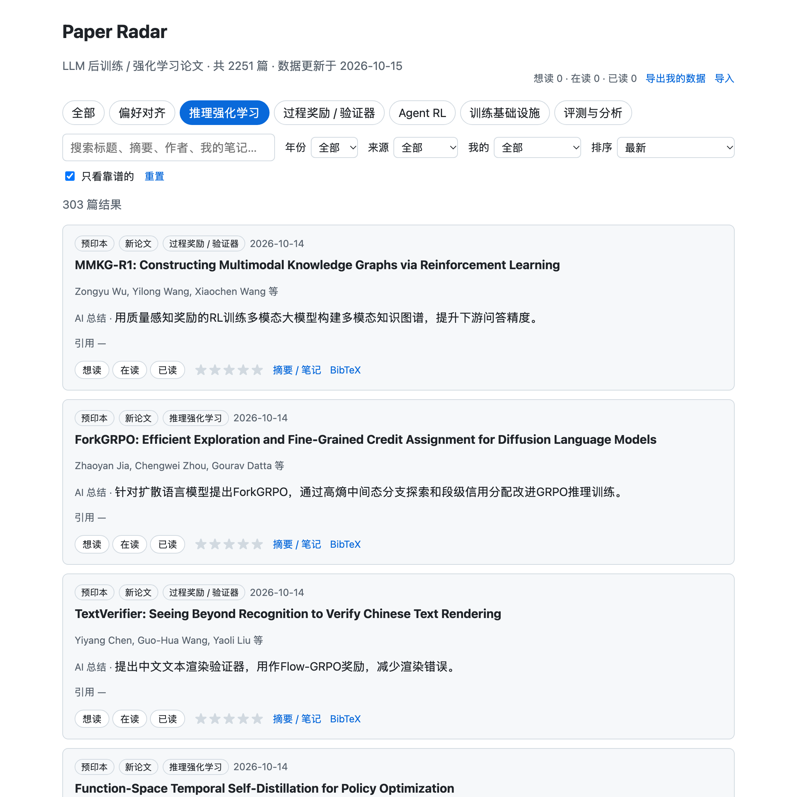

# Paper Radar：LLM 后训练论文索引

按细分方向收录近两年 LLM 后训练 / 强化学习论文（RLHF、DPO、GRPO/RLVR、过程奖励、Agent RL 等），
每篇附一句话中文总结和来源标签（已录用 / 预印本 / 技术报告）。阅读状态、评分和笔记保存在浏览器本地。

在线访问：https://polosnow-0926.github.io/PaperReader/



> 状态：项目已暂停，当前数据不完整。
> - `web/public/papers.json` 生成于 2026-10-15，覆盖 2024-11 至 2026-10。已完成 LLM 分类的 3071 篇候选里有 2251 篇判定为相关
> - 没有引用数据：Semantic Scholar API key 未获批，所有论文的引用数都是空的（页面显示"—"）

## 功能

- 6 个细分方向标签页，按主分类或次分类筛选
- 搜索标题、摘要、作者、AI 总结和自己的笔记，多个关键词之间是"且"的关系
- 按年份、来源、我的阅读状态筛选；按影响力、总引用、最新、我的评分排序
- 默认只显示"靠谱"的论文（规则见下文），取消勾选可以看全部
- 每篇论文可以标记想读 / 在读 / 已读、打 1–5 星、写笔记、复制 BibTeX
- 筛选条件会同步到 URL，复制链接就能分享当前视图
- 个人数据可以导出成 JSON，也可以导入合并（同一篇论文保留较新的修改）



## 细分方向

| key | 方向 | 范围 | 当前篇数 |
| --- | --- | --- | --- |
| `preference_alignment` | 偏好对齐 | RLHF/PPO、DPO 及变体、Reward Model 训练、AI 反馈 | 816 |
| `reasoning_rl` | 推理强化学习 | GRPO、RLVR（可验证奖励）、长思维链（o1/R1 类） | 752 |
| `agent_rl` | Agent RL | 多轮交互、工具调用、搜索、环境交互 | 314 |
| `analysis` | 评测与分析 | reward hacking、RL 到底教会了模型什么、对齐税等 | 179 |
| `process_reward` | 过程奖励 / 验证器 | PRM、ORM、生成式验证器 | 148 |
| `infra` | 训练基础设施 | verl、OpenRLHF 等 RL 训练框架、rollout/训练效率优化 | 42 |

篇数按主分类统计。定义在 `paper_radar/config.py` 的 `CATEGORIES`，修改后需要更新 prompt 版本并重新分类。

## 数据流水线

`paper_radar/build.py` 按以下步骤生成 `web/public/papers.json`：

1. 抓取候选（`harvest.py`）：按月查询 arXiv API，要求摘要里同时有 RL/偏好优化类关键词（reinforcement learning、RLHF、DPO、GRPO、reward model 等）和语言模型类关键词（language model、LLM）。初筛宁宽勿严。种子必读论文（`SEEDS`，如 PPO、InstructGPT、DPO、DeepSeek-R1、DAPO）不受时间范围限制，一定收录
2. LLM 分类（`prompts.py` + `llm.py`）：把标题和摘要发给 DeepSeek（通过 OpenAI 兼容接口），返回是否相关、置信度、主/次分类和一句话中文总结。只做 SFT、纯预训练、不涉及语言模型的经典 RL 都判为不相关
3. 引用与录用信息（`semantic_scholar.py`）：从 Semantic Scholar 批量获取引用数、高影响力引用数和发表会议
4. 来源标签（`venue.py`）：优先用 Semantic Scholar 的 venue，其次解析 arXiv comment / journal_ref，判断是否被顶会顶刊录用（NeurIPS、ICML、ICLR、ACL、EMNLP、NAACL、COLM、AAAI、IJCAI、TMLR、JMLR、Nature、Science），并识别 Oral / Spotlight。写明 under review、workshop 的不算录用
5. 计算"靠谱"等级，按发布日期倒序写出 JSON

## "靠谱"规则

每篇论文会得到一个等级，按顺序判断，命中第一条即停：

| 等级 | 条件 | 当前篇数 |
| --- | --- | --- |
| `seed` 必读 | 在种子列表里 | 17 |
| `published` 已录用 | 被上面列出的顶会顶刊录用 | 437 |
| `cited` 引用活跃 | 引用 ≥ 5 且月均引用 ≥ 1 | 0（没有引用数据） |
| `tech_report` 技术报告 | 标题或 comment 里写了 technical report | 37 |
| `new` 新论文 | 发布不满 60 天，还来不及积累引用 | 236 |
| `unvetted` 待观察 | 以上都不满足 | 1524 |

"只看靠谱的"会隐藏 `unvetted`。门槛在 `build.py` 顶部（`NEW_PAPER_DAYS`、`MIN_CITATIONS_PER_MONTH`、`MIN_CITATIONS_ABS`）。

## 本地运行

需要 Python ≥ 3.12、[uv](https://docs.astral.sh/uv/)、Node.js 22。

```bash
cp .env.example .env        # 填写配置，见下表
uv sync

# 抓取 + 分类，输出 web/public/papers.json
uv run python -m paper_radar.build --dry-run       # 只抓取并估算成本，不调用 LLM
uv run python -m paper_radar.build --months 1      # 只跑最近 1 个月（试跑 / 增量更新）
uv run python -m paper_radar.build                 # 近两年全量（默认 --months 24）
uv run python -m paper_radar.build --cached-only   # 只用已缓存的分类结果重新生成数据，不调用付费或限流接口

cd web && npm install && npm run dev               # 打开 http://localhost:5173
```

`.env` 配置项：

| 变量 | 说明 |
| --- | --- |
| `DEEPSEEK_BASE_URL` | OpenAI 兼容接口地址，中转站一般以 `/v1` 结尾。默认 `https://api.deepseek.com` |
| `DEEPSEEK_API_KEY` | 必填 |
| `DEEPSEEK_MODEL` | 默认 `deepseek-v4-flash-0731` |
| `PRICE_INPUT` / `PRICE_INPUT_CACHE_HIT` / `PRICE_OUTPUT` | 可选，单价（美元 / 百万 tokens），用于计算成本。不填只报告 token 用量 |
| `S2_API_KEY` | 可选，Semantic Scholar key。不填时限流很严，大部分请求会失败 |

`.env` 已在 `.gitignore` 中，不会被提交。

## 缓存与成本

所有缓存都在 `.cache/` 下（不提交到仓库）：

- `.cache/llm/`：每次 LLM 调用的结果，按模型、prompt 版本和输入内容做哈希。重跑不会重复计费
- `.cache/harvest/`：已结束月份的 arXiv 抓取结果。当月每次重新抓
- `.cache/s2.json`：Semantic Scholar 数据，缓存 7 天。被限流跳过的论文下次运行会补上

修改 prompt 后把 `paper_radar/config.py` 里的 `PROMPT_VERSION` 加 1，旧缓存会自动失效。

分类一篇论文平均约 740 输入 token、230 输出 token。arXiv 要求每 3 秒最多一次请求，抓取两年的候选需要一段时间。

## 部署

每次推送到 `main`，`.github/workflows/update.yml` 会运行前端测试，用仓库里已提交的 `web/public/papers.json` 构建并部署到 GitHub Pages。整个过程不调用任何 LLM 或外部 API，不需要配置 Secrets。

首次使用需要在仓库 Settings → Pages → Build and deployment 里把 Source 设为 "GitHub Actions"。

更新线上数据的流程：本地跑 `build` 生成新的 `papers.json`，提交并推送。

## 个人数据

阅读状态、评分、笔记只存在浏览器 localStorage（键名 `paper-radar:user:v1`），不会上传到任何地方。换浏览器、换设备或清缓存前，用页面右上角的"导出我的数据"备份，之后再"导入"即可。

## 测试

```bash
uv run pytest                 # 后端：arXiv 解析、来源标签、章节抽取、LLM 输出校验
cd web && npm test            # 前端：筛选排序、URL 同步、个人数据校验、BibTeX
```

## 目录结构

```
paper_radar/
  build.py              全量流水线入口
  harvest.py            按月抓取 arXiv 候选
  arxiv.py              arXiv API 封装（含 3 秒限速）
  llm.py                DeepSeek 调用、JSON 解析、磁盘缓存、用量统计
  prompts.py            分类 / 字段抽取 prompt 及输出校验
  semantic_scholar.py   引用数据
  venue.py              来源标签
  sections.py           从 arXiv HTML 抽取关键章节（试点用）
  config.py             模型、细分方向、单价等配置
  http.py               带重试和退避的 HTTP 客户端
web/
  src/App.tsx           页面
  src/lib.ts            筛选排序、URL 同步、个人数据、BibTeX
  public/papers.json    网站数据
pilot/                  100 篇样本的准确率与成本试点
tests/                  后端测试
docs/                   截图
```

## 已知问题

- 没有引用数据，"影响力"和"总引用"排序实际上只是把必读论文放在最前面，其余论文仍按发布日期倒序
- 卡片上只显示主分类。按某个方向筛选时，靠次分类匹配进来的论文看起来像是分错了
- LLM 相关性判断偶尔会放进偏题的论文，"只看靠谱的"只看来源和引用，不会二次过滤相关性

## 试点（已完成）

全量运行前，在 `pilot/` 里用 103 篇样本（种子论文 + 随机候选）验证了分类准确率和成本：

```bash
uv run python -m pilot.build_sample      # 生成样本
uv run python -m pilot.run_pilot         # 跑分类 + 全文字段抽取（算法、奖励类型、基座模型、算力等）
uv run python -m pilot.evaluate          # 和 pilot/labels.csv 的人工标注对比
```

字段抽取（`prompts.EXTRACT_SYSTEM` + `sections.py`）只在试点里用过，全量流水线目前只做分类和一句话总结。
